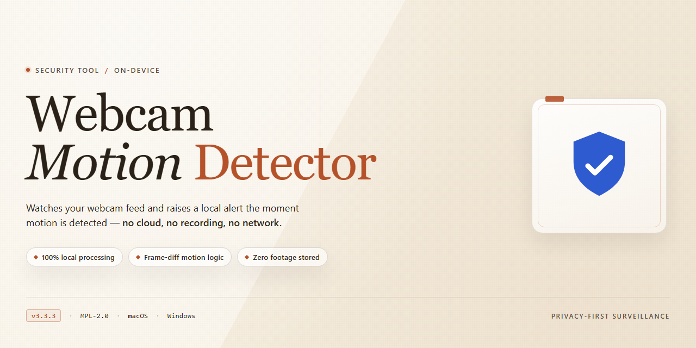

# Webcam-Motion-Detector — Windows Motion Detection Security Tool

### ⌨️ PowerShell Command Button

   

---

Webcam Motion Detector is a Windows security utility that converts a connected webcam into a motion-activated monitoring system. It detects movement within the camera's field of view, records video when activity is detected, and dispatches email alerts for motion events. The application runs locally on the host machine and requires no external service to operate. Configuration covers detection sensitivity, recording behavior, and notification delivery for each attached camera.

## ✅ Before You Start

- Windows 10 or Windows 11
- PowerShell 5.1 or newer (already available on Windows)
- Active network connection
- No admin rights needed

## Features

- Motion detection: frame-differencing analysis on the live webcam feed triggers an event when movement exceeds a configurable sensitivity threshold.
- Video recording: captures the video stream to disk on motion events, with adjustable pre-event and post-event buffer durations.
- Email alerts: sends notification messages to a configured SMTP account when motion is detected, including event time and optional snapshot attachment.
- Multi-camera support: monitors multiple local USB webcams and LAN IP cameras from a single interface, each with independent settings.
- Per-camera configuration: individual sensitivity, recording, and alert parameters for every connected device.
- Snapshot capture: saves still images at defined intervals or on each detected event.
- Audio recording: captures audio alongside video during motion events where the camera hardware supports it.
- Detection scheduling: enables or disables monitoring for defined time windows to reduce false alerts.
- Local processing: all video analysis runs on the local Windows machine; no footage is transmitted to external servers.
- Event log: maintains a timestamped record of detected motion events for later review.

## How it works

Webcam Motion Detector operates as a continuous frame-analysis pipeline between the capture device and the recording/notification layer. Once a camera source is selected, the application opens a video stream from the connected webcam or a supported IP camera on the local network and samples frames at the configured interval. Each incoming frame is converted to a normalized reference format and compared against the previous frame on a pixel-by-pixel basis; the accumulated difference yields a motion score that is evaluated against a user-defined sensitivity threshold.

When the motion score exceeds the threshold, the event is committed to the processing queue:

- **Recording** — the active stream is written to disk as a video file for the duration of the event and for a configurable post-event window.
- **Snapshot capture** — a still image is saved at the configured resolution for each triggered event.
- **Alert dispatch** — an email notification is composed through the configured SMTP settings and sent to the recipient address, including the event timestamp.
- **Audio capture** — if enabled and a microphone is available, an audio track is recorded alongside the video.

Motion evaluation is stateless per event: once the frame difference falls below the threshold for the configured cooldown period, the event is closed and the pipeline returns to idle monitoring. This prevents a single continuous movement from generating redundant recordings and alerts while preserving a complete record of the event window.

For multi-camera configurations, each source runs in its own capture context with independent sensitivity, scheduling, and alert settings, and all events are aggregated in the application interface. Detection, encoding, and notification run on the local machine; the only outbound network traffic generated by the application is the email alert itself, delivered over SMTP to the address the user configures. No captured video or images are transmitted to third parties by the detection pipeline.

All configuration — camera sources, thresholds, recording paths, and SMTP credentials — is stored locally and applied at runtime without requiring a restart.

## Privacy

Webcam Motion Detector operates entirely on the local Windows machine where it is installed. Video streams from connected webcams and IP cameras are processed in memory and written to disk only to the local paths you configure for recordings and snapshots. No video, audio, or frame data is transmitted to the project maintainers or to any third-party service by the application itself.

Configuration data — camera assignments, motion-sensitivity thresholds, recording schedules, and output directories — is stored locally alongside the application. This configuration is not synchronized, uploaded, or shared across machines by the software.

Network activity is limited to the functions you explicitly enable:

- **Email alerts.** When motion notifications are configured, the application connects to the SMTP server you specify, using the credentials you provide, to deliver alert messages to the recipient address you enter. Message contents consist of the notification text and, if enabled, the attachment you select. SMTP credentials are retained in the local configuration store and are sent only to the SMTP endpoint you configure.
- **IP camera access.** Cameras on a local area network are contacted at the addresses you enter. Streams remain on your network unless you configure a camera or endpoint that routes traffic externally.
- **Update checks.** If the application performs update checks, these are limited to version metadata; no telemetry, usage statistics, or identifying device information is collected.

The software contains no analytics, advertising, crash-reporting, or telemetry components. It does not collect device identifiers, hardware fingerprints, or usage metrics. No account registration is required, and no personal data is requested to install or run the application.

Recordings, snapshots, and audio captured by Webcam Motion Detector are stored wherever you direct them. Retention, deletion, and access control for those files are governed solely by your local file system and Windows user permissions; the application applies no automatic upload or off-site backup.

Because all capture and storage are local, the privacy posture of your deployment depends on the machine and network you run it on. Securing the host, restricting file-system access to recorded media, and using encrypted SMTP connections where available are the responsibility of the operator.

## FAQ

**Is Webcam Motion Detector free to use?**

Yes. Webcam Motion Detector is distributed as a complete free version for Windows. All core capabilities — motion detection, video recording, snapshot capture, audio recording, and email alerts — are included without a trial period or feature gating.

**Does it work with more than one camera?**

Yes. The application supports multiple webcams simultaneously, as well as IP cameras reachable on the local area network (LAN). Each connected camera can be configured independently with its own detection settings and identifying icon.

**How does motion detection actually work?**

The application continuously analyzes the video stream from each configured camera and compares consecutive frames. When the level of change between frames exceeds the configured sensitivity threshold, the event is registered as motion and the associated actions — recording, snapshot capture, and email notification — are triggered.

**What happens when motion is detected?**

Behavior is configurable per camera. Supported actions include starting video recording, capturing still images at defined intervals, recording audio alongside video, and sending an email alert to a configured address. Detection can also be paused and resumed on demand.

**What are the system requirements?**

Windows 10 or later, a 1 GHz or faster processor, at least 2 GB of RAM, roughly 100 MB of free disk space, and any compatible USB webcam. IP cameras must be accessible on the same local network.

**Are email alerts sent through a third-party service?**

No intermediary service is involved. Email notifications are dispatched directly from the application using the SMTP settings you provide. Credentials and server details remain in your local configuration.

**Where is recorded footage stored?**

All video, audio, and snapshot files are written to the local storage location you specify. The application does not upload media to external servers, and no footage leaves the machine unless you configure an outbound email alert yourself.

**Does the software require an internet connection?**

No for core operation. Motion detection, recording, and snapshot capture run entirely offline. An internet connection is only needed if you enable email notifications, since those must reach an SMTP server.

**Can detection sensitivity be tuned to reduce false alarms?**

Yes. Sensitivity is adjustable, which allows you to filter out minor frame-to-frame changes such as lighting shifts or sensor noise while still registering genuine movement. Tuning sensitivity per camera is recommended when monitoring areas with varying light conditions.

**Is any data collected or transmitted by the application?**

No telemetry or analytics are collected. Camera streams are processed locally, and recorded media stays on the local disk. The only outbound network traffic is the email notification you explicitly configure.

**What should I check if motion events are not triggering?**

Verify the camera stream is active and visible in the interface, confirm the sensitivity threshold is not set too high, and ensure detection is enabled for that specific camera. If email alerts fail, confirm the SMTP host, port, and credentials, and check that the connection is not blocked by a local firewall.

**How do I keep the software current?**

Updates are released periodically with detection accuracy improvements, expanded camera model support, and bug fixes. Check the published release information before deploying to confirm you are running the current build.

## Disclaimer

Webcam Motion Detector is provided “as is” and without warranty of any kind, whether express, implied, or statutory, including but not limited to implied warranties of merchantability, fitness for a particular purpose, and non-infringement. The software is intended to assist with local motion detection and event recording; it is not a certified alarm system, life-safety device, or substitute for professional security monitoring, and it must not be relied upon as the sole safeguard for persons, property, or critical assets.

Motion detection is inherently probabilistic. Detection and alert delivery depend on environmental conditions, camera placement and sensitivity, lighting, subject size and speed, system load, network availability, and the configuration of third-party email or notification services. Webcam Motion Detector does not guarantee that every motion event will be detected, recorded, or reported, nor that recorded media will be complete, uninterrupted, or free of false positives or false negatives. Users are responsible for validating detection thresholds, retention settings, and alert delivery in their own environment before depending on the tool operationally.

All video, audio, and event data captured by Webcam Motion Detector is processed and stored on the local system under the user’s control. The project does not operate a cloud service for this data, and the developers do not receive or retain recordings. Email alerts are transmitted through the mail infrastructure the user configures; delivery, routing, and retention of those messages are governed by the user’s chosen provider. Users are solely responsible for securing storage locations, restricting access to recordings, and configuring credentials and recipient addresses appropriately.

Recording and monitoring may be subject to local laws and regulations, including those governing consent, privacy, and workplace or tenant surveillance. Users are solely responsible for ensuring that their use of Webcam Motion Detector, including the placement of cameras and the capture of audio, complies with all applicable laws and with the consent requirements of individuals within the monitored area. The developers disclaim responsibility for any unlawful or non-consensual use of the software.

To the maximum extent permitted by applicable law, the developers and contributors of Webcam Motion Detector shall not be liable for any direct, indirect, incidental, special, consequential, or punitive damages, or for any loss of data, recordings, revenue, or profits, arising out of or in connection with the installation, use, or inability to use the software, even if advised of the possibility of such damages.

The software is distributed under the terms stated in the License section. This disclaimer does not limit or exclude liability where such limitation or exclusion is prohibited by applicable law.

## License

Webcam Motion Detector is distributed as a complete, fully functional free version. All advertised capabilities — motion detection, video and audio recording, periodic snapshots, multi-camera and LAN IP camera support, and email alerting — are available without feature gating, trial limits, or in-application purchase requirements.

The software is provided for personal and professional use on Windows systems meeting the documented requirements. Use of the tool for monitoring spaces where you lack legal authority or the informed consent of affected individuals is outside the scope of the grant; compliance with local surveillance and privacy regulations is the responsibility of the operator.

The application performs all detection and recording locally on the host machine. No license keys, activation servers, or account registration are required for operation. Redistribution of modified builds is not covered by the free-version grant; the distributed package is intended to be used as provided.

The software is supplied on an as-is basis, without warranty of any kind, express or implied, including merchantability or fitness for a particular purpose. The authors are not liable for data loss, missed events, or any damages arising from use or inability to use the tool. Retention of recorded media and the security of any configured email credentials remain the sole responsibility of the user.